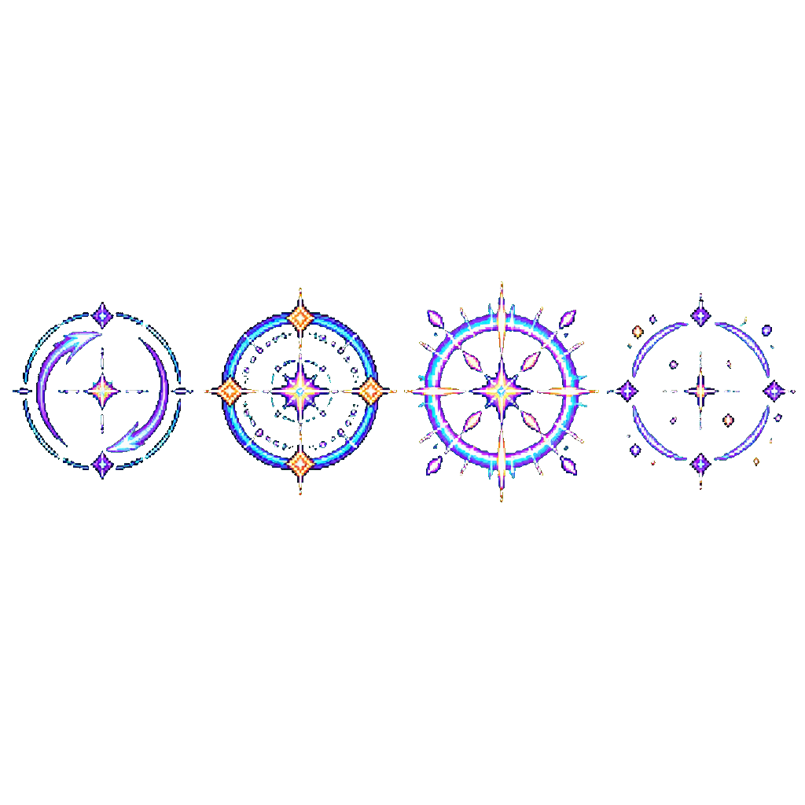
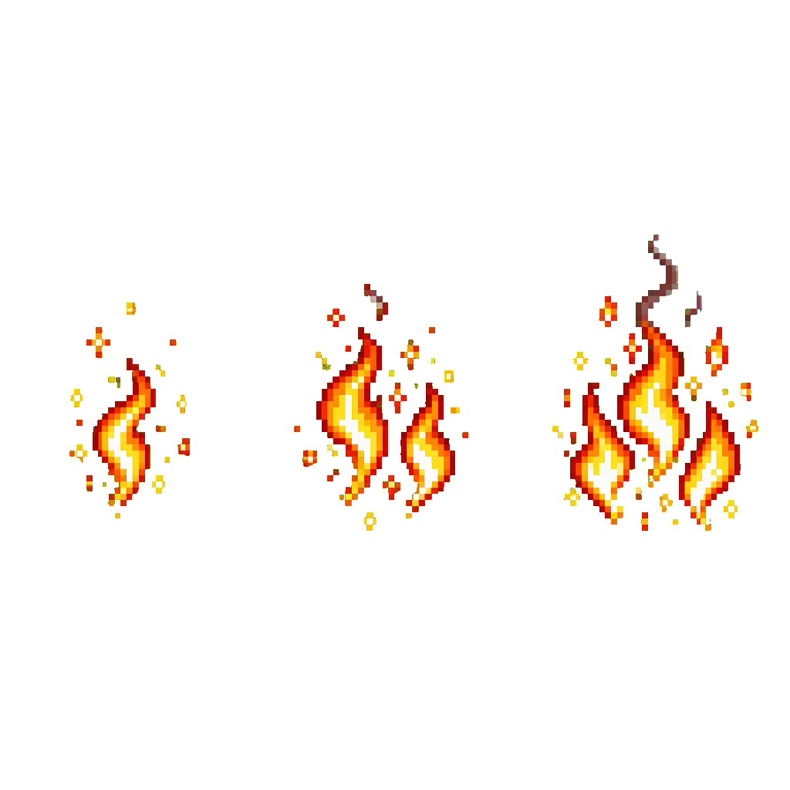
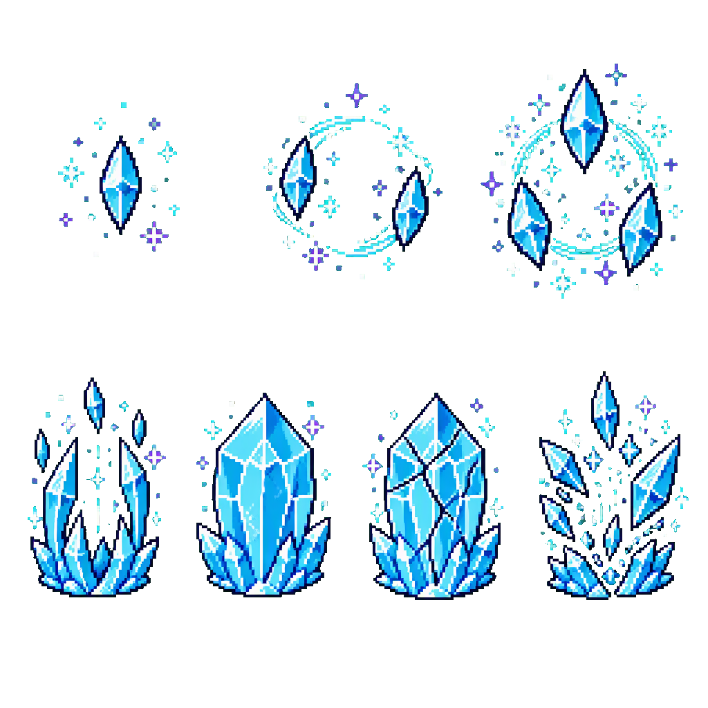
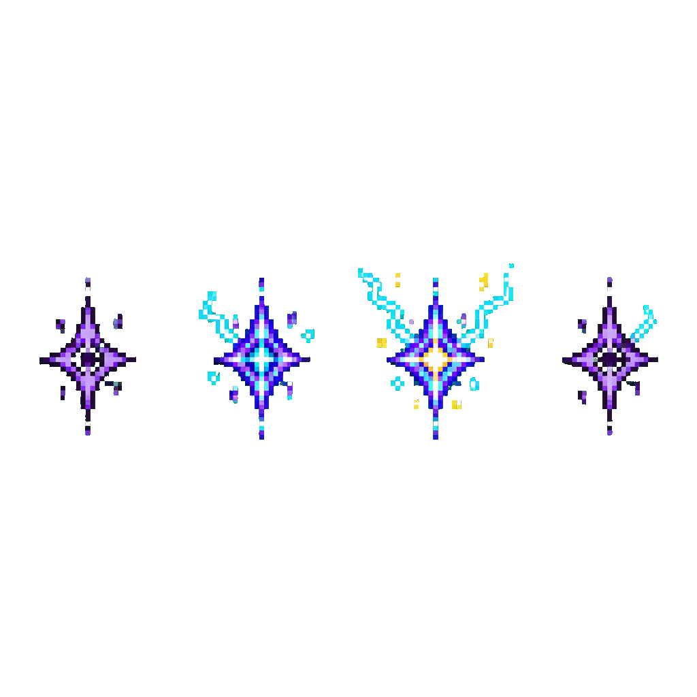
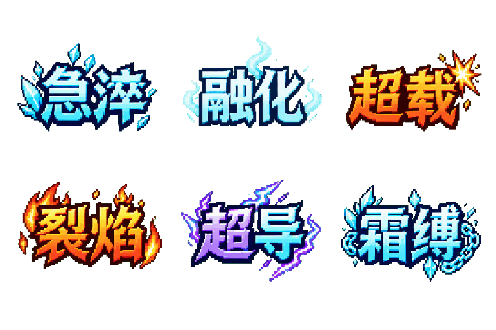

# 元素法师 VFX 美术简报与提示词（概念源图，2026-11-01）

> 状态：**概念源图 + 提示词已交付；v161 正式素材与未接入交接说明见 [技能交接包](mage-vfx-runtime.md)**。本批只交付素材与离线工具，正式技能接线由协作者负责。
>
> 适用：元素法师的法阵、灼烧、凝冰/冻结、雷印与六反应艺术字。
> 关联规则：`docs/elemental-mage-rework.md`（批次 1 只接入程序化表现；这些源图供后续 VFX 替换）。

## 1. 美术方向

元素法师的关键词：**神秘、优雅、简洁大气**。

- 神秘：紫/青/金的奥术色，符文与几何秩序，不靠堆叠烟雾或大面积闪光。
- 优雅：细环、短符文弧、干净对称；单个效果缩到 24–40px 仍能读出轮廓。
- 简洁大气：留白、低噪点、1px 硬边；避免写实火焰、粒子糊屏和全屏爆闪。
- 与现有 480×270 像素场景一致：16-bit 像素画、无抗锯齿/模糊/渐变、深色 ink 描边、少量高光。
- 元素色：火 `fireYellow #ffe14a` / `fireOrange #ff8c3a` / `fireDeep #c2410c`；冰 `iceCyan #57e6ff` / `iceDeep #1a9fd4`；雷 `psiViolet #8a5cff` / `psiPurple #b05cff`；通用高光 `white #ffffff` / `bone #e8e8f0` / `gold #ffd24a`；深描边 `ink0 #1a0a2a`。
- 色板真源：`src/game/data/palette.ts` / `assets/palette.gpl`。

## 2. 交付文件

| 文件 | 内容 | 源图尺寸 | 建议游戏内尺寸 |
|---|---|---|---|
| `assets/vfx/mage/mage-circle-source.png` | 法阵攻击 4 帧横排：起手 / 蓄势 / 爆裂 / 消散 | 1024×1024 | 单帧约 36×36 |
| `assets/vfx/mage/mage-burn-source.png` | 灼烧 3 档：1 / 2 / 3 层 | 1024×1024 | 单档约 28–34px |
| `assets/vfx/mage/mage-frost-source.png` | 上排凝冰 1/2/3 层；下排冻结 4 帧（成形/冰牢/裂纹/碎裂） | 1024×1024 | 单格约 28–40px |
| `assets/vfx/mage/mage-shock-source.png` | 雷印 4 帧横排：暗纹/充能/放电/淡出 | 1024×1024 | 单帧约 24–32px |
| `assets/vfx/mage/mage-reaction-words-source.png` | 六反应艺术字 3×2 总表 | 1536×1024 | UI 概念参考 |
| `assets/vfx/mage/wordmarks/reaction-*.png` | 六个单词切片：quench / melt / overload / blaze / superconduct / frostbind | 约 440–465px 宽 | 卡面/图鉴/详情页按需缩放 |

每个源图旁有同名 `.json`，记录透明像素、半透明像素与颜色数；`*-prompt.txt` 保存生成时使用的完整提示词与处理方式。

### 2.1 预览












## 3. 反应艺术字

六词与内部 id：

| 中文 | id | 元素方向（卡面/图鉴使用） |
|---|---|---|
| 急淬 | quench | 火→冰 |
| 融化 | melt | 冰→火 |
| 超载 | overload | 火→雷 |
| 裂焰 | blaze | 雷→火 |
| 超导 | superconduct | 冰→雷 |
| 霜缚 | frostbind | 雷→冰 |

使用边界：

- **战斗内飘字仍只显示两字名称**（如「急淬」），不带方向；这几个艺术字用于卡面、图鉴、结算/详情等静态 UI，不要直接替换战斗飘字，否则会重新引入可读性问题。
- 艺术字是**位图字标**，不是字体文件；UI 里要按图片缩放，不参与文本换行。
- 方向文本仍以规则文档的「名称（元素→元素）」为准。

## 4. 生成与复现

1. 用 ImageGen 按各 `*-prompt.txt` 的提示词生成，要求**纯绿幕 #00ff00**、无棋盘格、效果内不用绿色。
2. 使用 `scripts/chroma-key-mage-vfx.mjs` 抠绿并去边缘绿溢色：

```bash
node scripts/chroma-key-mage-vfx.mjs <输入.png> assets/vfx/mage/<名称>-source.png
# 反应艺术字额外切片：
node scripts/chroma-key-mage-vfx.mjs <输入.png> assets/vfx/mage/mage-reaction-words-source.png --slice-wordmarks
```

3. 脚本只做透明化、裁剪与六宫格切片，**不做降采样和调色板量化**；正式接入前需按运行时尺寸降采样并量化到 `palette.ts`（参考 `scripts/pixelize.mjs` 的预乘 alpha / Lab 最近色流程）。
4. ImageGen 未提供模型版本/seed，源图不可逐像素复现；提示词、日期和透明统计已留档。

## 5. 运行时接入建议（后续批次）

- **法阵**：当前程序化绘制圆环/读条；接入时用 `mage-circle-source.png` 切 4 帧，按施法进度映射帧，保持落点半径与实际判定一致。锚点为法阵中心，绘制在世界层、角色下层。
- **灼烧/凝冰/雷印**：作为敌人附加层，锚点为敌人中心；按状态层数选档/选帧。不要改变现有 0.5 秒灼烧 tick、凝冰层数与冻结/霜牢判定。
- **冻结**：下排 4 帧对应成形→冰牢→裂纹→碎裂；裂纹帧可绑定剩余冻结时间，不要在冻结开始时直接播放碎裂。
- **混合方式**：优先普通 alpha；能量高光可加 additive，但不能盖住血条、伤害数字和元素轮盘 HUD；不做全屏闪白。
- **尺寸**：先在 1× 游戏分辨率下检查 24–40px 可读性，再决定 2×/3× 缩放；禁止非整数缩放造成糊边。
- **状态颜色**：火光/冰青/雷紫必须与现有敌人染色和反应飘字色一致，避免同一状态出现两套颜色语言。

## 6. 验收与已知限制

- 已目视检查五张源图：法阵/灼烧/凝冰+冻结/雷印/六字均正确生成；六反应中文字逐字核对无错字。
- 已通过 `scripts/chroma-key-mage-vfx.mjs` 输出透明 PNG；`*-source.json` 记录透明/不透明/颜色数，绿幕已清除（源图无半透明边缘，便于后续二值 alpha 处理）。
- 未做：运行时接线、逐帧切片清单、锚点常量、降采样/调色板量化、动画时长与叠加发光测试、手机端性能测试。
- 反应艺术字为高分辨率位图源；若未来要在战斗 UI 中使用，需要先确定每字标的显示尺寸、九宫格/锚点和可读性，再单独接入。
