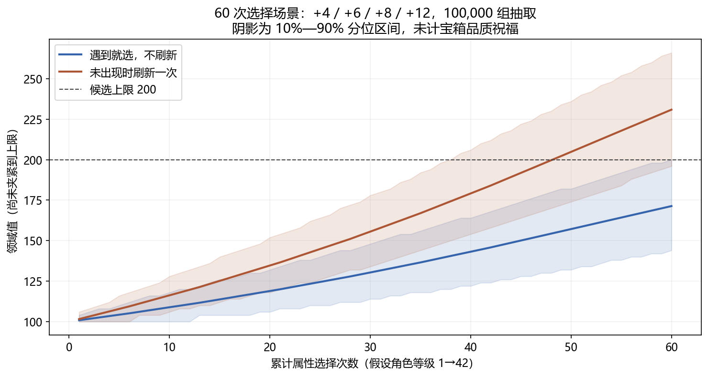
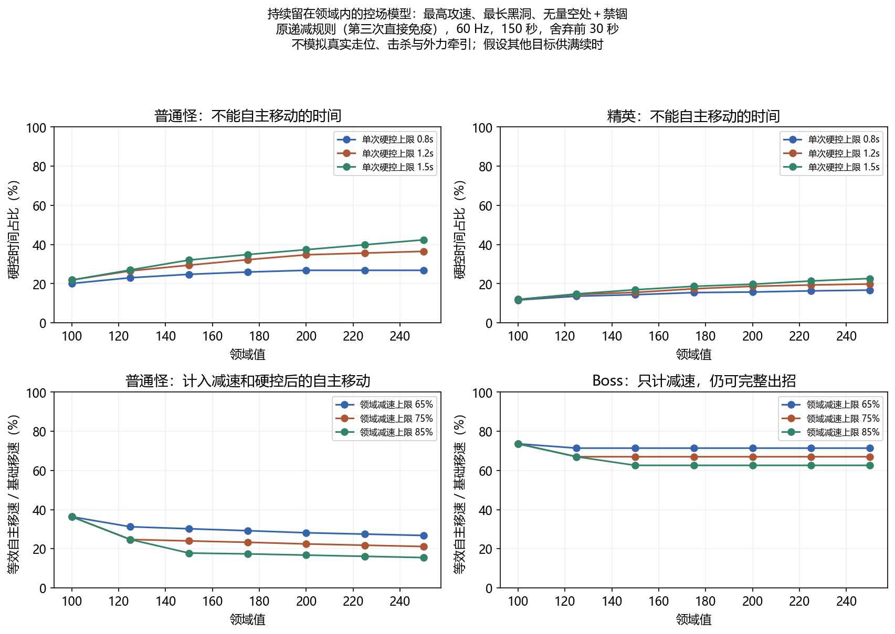

# 领域值参数离线模拟 · 2026-11-01

本报告评估设计参数，不是已实现武器的实机验收。没有修改运行时、敌人平衡、正式属性表或测试。

## 首版参数（用户已确认，尚未接入运行时）

| 项目 | 首版确认值 |
|---|---|
| 白/绿/紫/金领域值 | +4 / +6 / +8 / +12（白档 4 按现有品质倍率取整） |
| 领域值累计上限 | 200，基础为 100，最高独立倍率 ×2 |
| 领域武器最终减速上限 | 75%；Boss 再按现有 0.5 效果倍率，单来源最高 37.5% |
| 单次领域硬控上限 | 普通怪 1.2 秒，精英再乘 0.5 为最多 0.6 秒，Boss 免疫 |

用户随后已接受递减规则：100% → 50% → 25%，第三次控制后立即阻止后续申请，到第三次及已存在领域硬控结束后再留足 2 秒免疫，免疫结束清零；主设计第 8.4 节已同步。下文保留原规则与候选的模拟数据/图表作对照，不代表武器已经实现或试玩。

## 模型与输入

- 随机种子 20261101；每个选择预算 100,000 条抽取轨迹，比较 216 组成长参数。
- 40/60/80 次属性消费是预算敏感性场景，不是实际一局必得次数；每组内假设角色等级随选择从 1 均匀升至 42。
- 使用当前 AttributeSystem 的等级品质概率与 1/1.5/2.1/2.9 倍率，整数加点按 JS Math.round 的正数规则取整。
- 六种输出属性中有一种领域值；普通策略不刷新，出现即选；专刷策略未出现时刷新整个面板一次，出现仍必选。其余选择去向不模拟。
- 主表未计宝箱品质祝福与其他属性满额后缩小候选池；额外输出全部领域选择获 +1 品质、四种输出候选的压力场景。
- 150 秒 / 60 Hz 控制时间线，舍弃前 30 秒；三个施法/黑洞场景，扫描领域值、减速上限、硬控上限与敌人类别，共 945 组。
- 目标不死亡、持续位于所有生效范围内。满配 2.2 秒黑洞假设其他目标提供全部击杀续时；不模拟真实走位、几何、敌人 AI、击杀、完整抽卡或净牵引位移。
- 硬控时长向上对齐到固定步；忽略浮点噪声，不把精确百分比当成实机承诺。另比较 36 组收拢期脉冲敏感性、72 组递减候选和 96 组新目标前三秒接触。

## 品质梯度比较

固定 60 次属性选择、领域值上限 200；均值已夹紧上限。

| 梯度 | 策略 | 平均领域值 | 10%–90%区间 | 到顶比例 |
|---|---|---:|---|---:|
| +3/5/6/9 | 遇到就选 | 154.9 | 134–177 | 0.8% |
| +4/6/8/12 | 遇到就选 | 170.1 | 144–200 | 11.2% |
| +5/8/11/15 | 遇到就选 | 184.7 | 157–200 | 39.7% |
| +3/5/6/9 | 专门刷新 | 192.0 | 174–200 | 51.5% |
| +4/6/8/12 | 专门刷新 | 198.4 | 196–200 | 87.8% |
| +5/8/11/15 | 专门刷新 | 199.8 | 200–200 | 98.1% |

+4 档让普通选择保持成长空间，专门投入的长局构筑大多能到顶；+5 档明显提前封顶。+3 档可作为偏保守的替代方案，当前不需要先砍独立乘区覆盖范围。

## 上限敏感性

+4 档、60 次选择、专门刷新、无品质祝福。

| 上限 | 平均领域值 | 到顶比例 |
|---|---:|---:|
| 150 | 150.0 | 100.0% |
| 175 | 174.9 | 98.3% |
| 200 | 198.4 | 87.8% |
| 225 | 216.7 | 57.4% |

## 控制上限比较

最高攻速、最长黑洞、持续覆盖，沿用原第三次直接免疫的递减。自主移速比只反映减速和硬控，不包含向心牵引；不能当成敌人的实际净移动速度。

| 单次硬控上限 | V=200 普通怪硬控时间占比 |
|---|---:|
| 0.8 秒 | 26.8% |
| 1.0 秒 | 30.8% |
| 1.2 秒 | 34.8% |
| 1.5 秒 | 37.4% |
| 2.0 秒 | 41.8% |

| 减速上限 | 普通怪等效自主移速比 | Boss 等效自主移速比 |
|---|---:|---:|
| 65% | 28.2% | 71.4% |
| 75% | 22.5% | 67.0% |
| 85% | 16.8% | 62.6% |

75% 保留普通怪 25% 的未硬控时自主移速下限，Boss 对单次减速保留至少 62.5%；时间线中实际平均仍取决于覆盖。1.2 秒硬控上限能保留基础定身，精英半效与共享免疫继续生效。

## 额外发现：眩晕与禁锢争抢递减次数

基础施法周期中，前两次领域眩晕可能先用掉完整/半效次数，收拢时的定身成为第三次而完全被挡。目标持续覆盖的本模型中，原规则的基础节奏定身占比为 0；这不是所有真实敌人都必然出现的结论。

| 节奏 | 领域值 | 第三次规则 | 总硬控占比 | 定身占比 | 可攻击时间 |
|---|---:|---|---:|---:|---:|
| 基础 | 100 | 直接免疫 | 31.4% | 0.0% | 68.6% |
| 基础 | 100 | 25%后留足2秒免疫 | 25.5% | 10.8% | 81.3% |
| 基础 | 200 | 直接免疫 | 44.5% | 0.0% | 55.5% |
| 基础 | 200 | 25%后留足2秒免疫 | 36.3% | 16.5% | 68.3% |
| 最高攻速/最长黑洞 | 100 | 直接免疫 | 21.9% | 8.8% | 85.1% |
| 最高攻速/最长黑洞 | 100 | 25%后留足2秒免疫 | 21.9% | 9.4% | 84.5% |
| 最高攻速/最长黑洞 | 200 | 直接免疫 | 34.8% | 10.5% | 71.9% |
| 最高攻速/最长黑洞 | 200 | 25%后留足2秒免疫 | 29.5% | 11.5% | 76.7% |

该递减方案已获用户确认采用：给禁锢留下有限收益，完整免疫间隔会压低部分长时覆盖场景的总硬控占比；这些仍是离线模型结果，实际表现待实现与试玩。

### 新目标前三秒的相位敏感性

V=200，12 个入场相位（0–2.2 秒间隔），不是随机真实敌群。短接触并非总会随候选规则下降。

| 节奏/普通怪 | 第三次规则 | 平均硬控占比 | 相位最大硬控占比 |
|---|---|---:|---:|
| 基础 | 直接免疫 | 47.2% | 58.3% |
| 基础 | 25%后留足2秒免疫 | 48.9% | 63.3% |
| 最高攻速/最长黑洞 | 直接免疫 | 44.4% | 60.0% |
| 最高攻速/最长黑洞 | 25%后留足2秒免疫 | 40.1% | 41.1% |

因此该候选是改善控制配合的取舍，不是所有场景的纯削控；不能仅用长时平均认定普通波次已平衡。

## 复算与证据边界

- 从仓库目录运行：`python docs/simulations/domain-value-20261101/simulate.py`；复用现有 Python、NumPy 与 Matplotlib，不安装依赖。
- `results.json` 保存全部参数组合、预算敏感性、伤害公式与短接触场景；脚本生成本报告和两张图。
- +4 领域点在 V=100 时提供 4% 的允许伤害增长，V=150 时为约 2.67%；另有控制/生存收益。作为比较，+2 攻击在 D=20 时为 10% 的攻击力增长，不能把两者当成完全等价的总收益。
- 这些输出用于选择首版参数，无法证明清场效率、Boss 击杀时间、自然构筑分布、游戏帧时间或最终平衡。
